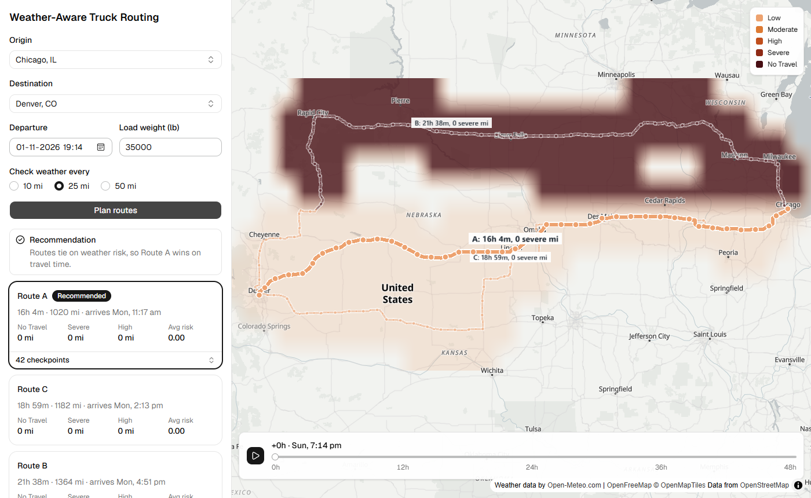
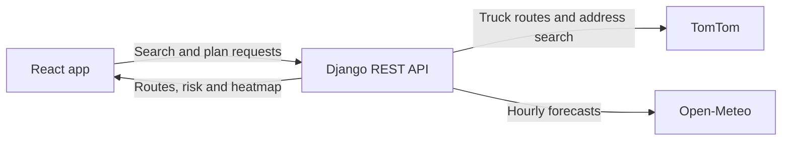

# Weather-Aware Truck Routing

A full-stack web app that helps a truck driver choose the safest route based on weather, load weight and travel time. Enter a trip, and the app compares up to three truck routes, reads the forecast for the moment the truck reaches each checkpoint, scores the risk, and recommends a route.

Built with React and Django for the Spotter full stack developer assessment.

| | |
|---|---|
| **Live app** | *To be added after deployment* |
| **Video walkthrough** | *To be added* |



*Chicago to Denver with a simulated storm. The northern route has 1,100 No Travel miles, so it ranks last. Route colours show the weather at the truck's arrival time, and the heatmap shows the hour chosen on the slider.*

## Contents

- [Features](#features)
- [How it works](#how-it-works)
- [Tech stack](#tech-stack)
- [Getting started](#getting-started)
- [Configuration](#configuration)
- [Using the app](#using-the-app)
- [Risk model](#risk-model)
- [Design decisions](#design-decisions)
- [API reference](#api-reference)
- [Project structure](#project-structure)
- [Testing](#testing)
- [Performance](#performance)
- [Deployment](#deployment)
- [Known limitations](#known-limitations)
- [Data sources and credits](#data-sources-and-credits)

## Features

- **Truck routing:** up to three distinct truck routes per trip, using a truck profile that includes the load weight.
- **Worldwide search:** address autocomplete in any language, with English place names that include the country.
- **ETA-aware weather:** each checkpoint uses the forecast for the truck's arrival time, not the departure time.
- **Configurable sampling:** checkpoints every 10, 25 or 50 miles.
- **Risk scoring:** wind, rain and snow are classified by the specified thresholds, and load rules raise the risk for heavy trucks in strong wind.
- **Clear recommendation:** routes are ranked by a fixed order, with a sentence explaining the result. If every route crosses No Travel conditions, the app says not to depart.
- **Interactive map:** all routes, risk-coloured road segments, checkpoints, ETAs and route summaries, with tooltips on hover.
- **48-hour heatmap:** a weather risk heatmap along the trip corridor, with a smooth slider and a Play button.
- **Accessible controls:** the form and slider work from the keyboard, and every checkpoint is also available as text in a table.

## How it works



Each call to `POST /api/plan` runs these steps:

1. **Find routes.** Request truck routes from TomTom, remove near-duplicates, and fill any gaps with other route types.
2. **Place checkpoints.** Add a checkpoint at each interval, using TomTom's travel time along the route to work out its ETA.
3. **Fetch forecasts.** Group nearby points into forecast cells, reuse cached cells, and fetch the rest in batches.
4. **Score each checkpoint.** Read the forecast at the ETA and classify the risk.
5. **Rank the routes.** Total the miles at each risk level and sort the routes by the ranking order.
6. **Build the heatmap.** Encode a risk level for every corridor cell for each of the 49 hours.

The server does all the risk scoring, so there is one copy of the rules. The browser receives all 49 heatmap hours at once, so moving the slider never touches the network.

## Tech stack

| Area | Technology |
|---|---|
| Backend | Python, Django 6.1, Django REST Framework 3.18, httpx |
| Frontend | React 19, TypeScript 7, Vite 8 |
| UI | Tailwind CSS 4, shadcn/ui (Radix), lucide icons |
| Map | MapLibre GL JS 6, deck.gl 9.4, OpenFreeMap tiles |
| Data fetching | TanStack Query 5 |
| Routing and search | TomTom Routing API, TomTom Search API |
| Weather | Open-Meteo Forecast API |
| Testing | pytest, pytest-django, respx, Vitest |
| Tooling | oxlint |

The app needs no database. Nothing is stored permanently, and forecasts and search results are cached in memory.

## Getting started

### Prerequisites

- Python 3.12 or newer
- Node.js 20.19+ or 22.12+
- A free [TomTom Developer](https://developer.tomtom.com/) API key

Open-Meteo needs no key.

### 1. Clone the repository

```bash
git clone https://github.com/Rio-awsm/driver-route-estimation.git
cd driver-route-estimation
```

### 2. Start the backend

macOS or Linux:

```bash
cd backend
python3 -m venv .venv
source .venv/bin/activate
pip install -r requirements-dev.txt
cp .env.example .env
```

Windows PowerShell:

```powershell
cd backend
python -m venv .venv
.\.venv\Scripts\Activate.ps1
pip install -r requirements-dev.txt
Copy-Item .env.example .env
```

Open `backend/.env`, set `TOMTOM_API_KEY` to your key, and set `DJANGO_SECRET_KEY` to any long random string. Then start the server:

```bash
python manage.py runserver
```

The API runs at http://localhost:8000. Check it at http://localhost:8000/api/health, which returns `{"status": "ok"}`.

### 3. Start the frontend

In a second terminal, from the project root:

```bash
cd frontend
npm install
npm run dev
```

Open http://localhost:5173. In development, Vite forwards `/api` requests to the backend, so no extra setup is needed.

## Configuration

### Backend

Set these in `backend/.env`.

| Variable | Required | Description |
|---|---|---|
| `TOMTOM_API_KEY` | Yes | TomTom API key. It stays on the server and is never sent to the browser. |
| `DJANGO_SECRET_KEY` | In production | Django secret key. A development default applies when debug mode is on. |
| `DJANGO_DEBUG` | No | Set to `true` for local development. Defaults to `false`. |
| `OPEN_METEO_URL` | No | Overrides the Open-Meteo forecast URL. |

### Frontend

| Variable | Required | Description |
|---|---|---|
| `VITE_API_URL` | In production | Base URL of the API, with no trailing slash. Leave it unset in development. |

`VITE_API_URL` is built into the JavaScript, so changing it needs a new build. Never give a secret a `VITE_` prefix, because those values are public.

## Using the app

1. Search for an origin and a destination.
2. Choose a departure time and enter the load weight in pounds.
3. Choose how often to check the weather: every 10, 25 or 50 miles.
4. Select **Plan routes**. Most trips take a few seconds, and long trips can take a minute or two.
5. Read the recommendation, then select a route card or a route on the map to compare options.
6. Hover over a checkpoint, or open the checkpoint table, to see its ETA, risk and weather.
7. Drag the slider or select Play to move through the next 48 hours. Hour 0 is your departure time.

### Simulate a storm

Real weather is often calm, which leaves every route at Low risk. To see the risk logic working, run the API with a simulated storm instead of `runserver`:

```bash
cd backend
python scripts/dev_storm.py
```

This keeps the real routes, and adds 50 mph wind north of latitude 42° for the first 24 hours. Plan Chicago to Denver with a 35,000 lb load:

- The northern route gains No Travel miles and ranks last.
- With a 25,000 lb load, the same road shows Severe instead.
- The storm fades from the heatmap at +24h.

Route letters follow TomTom's order and can change with the load, so compare routes by distance. Use this tool locally only, and never deploy it.

## Risk model

### Weather thresholds

Each checkpoint takes the worst level across wind, rain and snow.

| Condition | Low | Moderate | High | Severe | No Travel |
|---|---|---|---|---|---|
| Wind (mph) | < 25 | 25 to < 35 | 35 to < 45 | 45 to < 55 | ≥ 55 |
| Rain (in/hr) | < 0.10 | 0.10 to < 0.25 | 0.25 to < 0.50 | 0.50 to 1.00 | > 1.00 |
| Snow (in/hr) | < 0.5 | 0.5 to < 1.0 | 1.0 to < 2.0 | 2.0 to 3.0 | > 3.0 |

### Load rules

| Wind | Load | Result |
|---|---|---|
| ≥ 55 mph | Any | No Travel |
| 45 to < 55 mph | Over 30,000 lb | No Travel |
| 35 to < 45 mph | Over 40,000 lb | Severe |

Exactly 30,000 lb or 40,000 lb is not raised, because the rules apply to loads over those weights.

### Route ranking

Routes are compared in this order, and the first difference decides:

1. Fewest No Travel miles
2. Fewest Severe miles
3. Fewest High miles
4. Lowest average risk
5. Shortest travel time

Average risk scores the levels from 0 (Low) to 4 (No Travel), weighted by miles. Each checkpoint owns the stretch of road nearest to it, so the miles always add up to the route length.

### Interpreting the rules

The specification leaves some cases open. These are the decisions made:

| Case | Decision |
|---|---|
| The ranking list doesn't mention No Travel | No Travel miles rank first, so a forbidden route can't beat a legal one |
| Every route crosses No Travel conditions | The least bad route is shown with a "Do not depart" warning |
| A value sits on a boundary between two bands | It takes the higher band, the safer reading |
| Exactly 1.00 in/hr of rain or 3.0 in/hr of snow | Stays Severe, because No Travel is defined as greater than those values |
| Wind between bands, such as 34.5 mph | Each band runs up to the next threshold |
| Rain measurement | `rain` plus `showers`, because Open-Meteo's `precipitation` also includes snow |
| Sustained wind or gusts | The rules use sustained wind. Gusts are displayed but don't change the level |
| Forecast timing | Wind is instantaneous, so it is interpolated. Rain, snow and gusts cover the preceding hour, so a 14:20 arrival reads the 15:00 value |

## Design decisions

### Three routes on any map

TomTom can return fewer alternatives than requested, depending on the road network. The app asks for alternatives first, then for the shortest, toll-free and motorway-free routes. A forced detour through a point beside the route is the last resort, because that point can land in the sea on a coastal trip. Routes that overlap by 95% or more count as the same route.

### Truck profile

The form asks only for load weight, so the rest of the truck uses typical tractor-trailer values: 35,000 lb empty, 4.1 m tall, 2.6 m wide, 5 axles and a 105 km/h top speed. It starts at 21 m long. Many countries ban trucks of that length, so a route that fails is retried once at the European length of 16.5 m.

### Staying inside weather limits

Open-Meteo counts each location as at least one call, and the free tier allows 600 calls a minute and 10,000 a day. The app manages this in several ways:

- Each plan uses at most 550 locations: up to 350 for checkpoints, and whatever remains for the heatmap.
- Forecast grids start fine, and get coarser on long trips to stay within budget.
- Nearby checkpoints and shared highways reuse the same forecast.
- Forecasts are cached for 30 minutes per location and time window, so repeating a plan uses no weather calls.
- Requests go in batches of 200 using POST, because very long GET URLs are rejected.
- If the provider returns HTTP 429, the app waits 30 seconds and retries, up to twice. Finished batches stay cached, so a retry only fetches what is missing.

### A heatmap that keeps up with a slider

The server sends the heatmap as compact bytes rather than JSON objects. The browser converts each hour into one small image once, and moving the slider only changes which image deck.gl draws. Two neighbouring hours are stacked and faded so the slider glides between them, and GPU smoothing between cells gives the soft heatmap look. Slider movement bypasses React and redraws at most once per animation frame.

## API reference

All endpoints are under `/api`. The API is open: it needs no authentication, allows requests from any origin, and has no rate limits.

### `GET /api/health`

Returns `{"status": "ok"}`.

### `GET /api/geocode?q=<text>`

Searches for places worldwide. Queries shorter than 2 characters return an empty list, and results are cached for 24 hours.

```json
{
  "results": [
    { "label": "Denver, CO, United States", "lat": 39.738453, "lon": -104.984853 }
  ]
}
```

### `POST /api/plan`

Plans a trip.

```json
{
  "origin": { "label": "Chicago, IL", "lat": 41.8781, "lon": -87.6298 },
  "destination": { "label": "Denver, CO", "lat": 39.7392, "lon": -104.9903 },
  "departure": "2026-11-03T14:00:00Z",
  "load_lb": 35000,
  "interval_miles": 25
}
```

| Field | Rules |
|---|---|
| `origin`, `destination` | `label`, `lat` and `lon`. They must be different places |
| `departure` | ISO 8601 date and time, from one hour ago up to 7 days ahead |
| `load_lb` | Whole number from 0 to 120,000 |
| `interval_miles` | 10, 25 or 50. Defaults to 25 |

A successful response lists routes in ranked order, best first:

```json
{
  "departure": "2026-11-03T14:00:00+00:00",
  "load_lb": 35000,
  "interval_miles": 25,
  "recommended_route": "A",
  "blocked": false,
  "reason": "Routes tie on weather risk, so Route A wins on travel time.",
  "routes": [
    {
      "id": "A",
      "distance_miles": 1020.3,
      "duration_s": 57329,
      "arrival": "2026-11-04T05:55:29+00:00",
      "no_travel_miles": 0.0,
      "severe_miles": 0.0,
      "high_miles": 0.0,
      "average_risk": 0.0,
      "checkpoints": [
        {
          "mile": 0.0,
          "lat": 41.8781,
          "lon": -87.6298,
          "eta": "2026-11-03T14:00:00+00:00",
          "wind_mph": 6.9,
          "gust_mph": 12.1,
          "rain_in_hr": 0.0,
          "snow_in_hr": 0.0,
          "risk": 0,
          "risk_label": "Low",
          "risk_driver": "wind"
        }
      ],
      "segments": [{ "risk": 0, "path": [[-87.6298, 41.8781], [-87.65, 41.87]] }]
    }
  ],
  "heatmap": {
    "bounds": [-107.0, 36.0, -86.0, 45.6],
    "rows": 12,
    "cols": 33,
    "hours": 49,
    "start": "2026-11-03T14:00:00+00:00",
    "levels": "<base64>"
  }
}
```

- `blocked` is `true` when even the best route has No Travel miles.
- `risk` runs from 0 (Low) to 4 (No Travel).
- `bounds` is `[west, south, east, north]`.
- `levels` decodes to `rows × cols × hours` bytes, ordered by hour, then row from the north, then column from the west. Each byte is a risk level, and `255` means outside the corridor.

### Errors

| Status | Meaning | Body |
|---|---|---|
| `400` | Invalid input | Field names with messages |
| `422` | No truck route exists | `{"detail": "..."}` |
| `502` | A provider failed | `{"detail": "..."}` |
| `503` | The weather provider is still rate limiting after retries | `{"detail": "..."}` |

## Project structure

```text
.
├── assets/                     Images used in this README
├── backend/
│   ├── config/                 Django settings, URLs and WSGI entry point
│   ├── planner/
│   │   ├── clients/            TomTom and Open-Meteo clients
│   │   ├── domain/             Pure logic with no network calls
│   │   │   ├── risk.py         Risk thresholds and load rules
│   │   │   ├── ranking.py      Route scoring, ranking and explanation
│   │   │   ├── checkpoints.py  Checkpoint placement and ETAs
│   │   │   ├── weather.py      Reading a forecast at an exact time
│   │   │   ├── grid.py         Forecast cells and the heatmap corridor
│   │   │   ├── geo.py          Distances and line simplification
│   │   │   └── models.py       Route and checkpoint data types
│   │   ├── services/           Route selection and plan building
│   │   ├── exceptions.py       Provider errors returned as JSON
│   │   ├── serializers.py      Request validation
│   │   ├── urls.py             API routes
│   │   └── views.py            API endpoints
│   ├── scripts/dev_storm.py    Local storm simulator
│   └── tests/
└── frontend/
    └── src/
        ├── api/                API client and response types
        ├── components/         Trip form, route cards, legend and slider
        │   └── ui/             shadcn/ui components
        ├── lib/                Risk colours, formatting and helpers
        ├── map/                Map, deck.gl layers and heatmap frames
        └── App.tsx             Page layout and app state
```

## Testing

```bash
# Backend, from backend/ with the virtual environment active
pytest -q

# Frontend, from frontend/
npm test
npx tsc -b
npm run lint
npm run build
```

The suites contain 125 backend tests and 15 frontend tests. Network calls are faked, so the tests use no API quota.

| Area | What the tests cover |
|---|---|
| Risk rules | Every threshold boundary, load rule and worst-condition case |
| Ranking | Each step of the ranking order and the explanation text |
| Route maths | Checkpoint spacing, ETAs, zero-length segments and long routes |
| Forecast lookup | Interpolated wind, and rain and snow read from the covering hour |
| Grids | Location budgets on coast-to-coast trips and corridor alignment |
| Clients | Request parameters, batching, caching, retries and provider errors |
| Plan API | Input validation, timezones, long trips and clean error responses |
| Frontend | Error messages, formatting and heatmap image generation |

## Performance

Measured in Microsoft Edge on an integrated AMD Radeon GPU, using real routes.

| Measure | Result |
|---|---|
| Dragging the slider across all 48 hours | 134 to 139 fps, with a 6.9 ms median frame |
| Network calls while dragging | 0 |
| Chicago to Denver plan | About 6 to 12 seconds |
| Seattle to Miami plan, checkpoints every 10 miles | About 26 seconds, using 542 forecast locations |
| Compressed plan response | 16 KB for Chicago to Denver |

Timings vary with the hardware, the providers and how much is already cached. A plan that hits the weather rate limit waits and retries, and the slowest seen took 74 seconds.

## Deployment

The backend is a standard WSGI app, and the frontend builds to static files.

### Backend

```bash
pip install -r requirements.txt
gunicorn config.wsgi --workers 1 --threads 8 --timeout 120 --bind 0.0.0.0:$PORT
```

Run this from `backend/`, and set `TOMTOM_API_KEY` and `DJANGO_SECRET_KEY` in the environment. Use one worker with several threads, because the cache lives in process memory and each extra worker would keep its own copy.

### Frontend

```bash
npm ci
npm run build
```

Run this from `frontend/` with `VITE_API_URL` set to the API's URL, then serve the `dist` folder from any static host.

## Known limitations

- **No rest stops.** ETAs assume continuous driving, so they are optimistic on long trips. Hours of Service rules would be the next feature.
- **Sustained wind only.** Gusts are displayed but not scored, because the specification doesn't say which to use.
- **Strict ranking.** The order is followed literally, so one extra Severe mile outweighs any travel time. A small difference in average risk can also beat a much faster route.
- **Route letters aren't stable.** They follow TomTom's order, so the same road can get a different letter when the load or time changes.
- **Fewer than three routes.** Some corridors have no third distinct route, and the app shows a note when that happens.
- **Two truck lengths.** The app tries 21 m, then 16.5 m. It doesn't apply each country's legal limits.
- **Coverage varies.** Routing depends on TomTom's data, so some trips may return no route.
- **Units and times.** The app uses miles, pounds and mph, as the specification does. Times show in the browser's timezone, not the destination's.
- **Coarser forecasts on long trips.** Forecast cells grow to stay within the location budget, reaching 1.5° to 2° for heatmap cells on coast-to-coast trips.
- **Temporary cache.** The in-memory cache is lost on every restart.
- **Open API.** With no authentication or rate limits, heavy use could spend the TomTom and Open-Meteo quotas.
- **Free-tier limits.** At up to 550 locations a plan, Open-Meteo's daily limit allows about 18 uncached plans. The free tier is for non-commercial use, so a commercial product needs a paid plan.
- **Touch screens.** Tooltips need a mouse. Every checkpoint is still in the sidebar table.

## Data sources and credits

- Weather data by [Open-Meteo.com](https://open-meteo.com/)
- Routing and place search by [TomTom](https://developer.tomtom.com/)
- Map tiles by [OpenFreeMap](https://openfreemap.org/), with data from [OpenMapTiles](https://openmaptiles.org/) and [OpenStreetMap](https://www.openstreetmap.org/copyright) contributors
